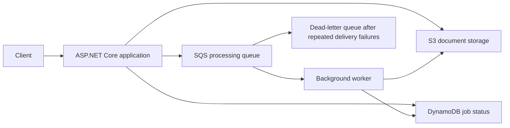

# Learning AWS Services with .NET

A hands-on learning project for using AWS services from an ASP.NET Core application with the official AWS SDK for .NET.

The project targets **.NET 10** and uses straightforward code so the focus stays on configuring services, making SDK requests, and understanding their behavior.

## Current state

The repository currently contains a runnable ASP.NET Core MVC baseline with:

- Standard application configuration and logging.
- A liveness endpoint at `/health`.
- Official SDK packages for Amazon S3, Amazon SQS, and Amazon DynamoDB.
- Typed AWS configuration with required-field validation at startup.
- Separate web and Worker hosts, each registering S3, SQS, and DynamoDB clients with its own local named profile.
- Service interfaces, AWS SDK service implementations, and result data contracts for the learning workflow.

The service implementations cover document storage, job persistence, messaging, and text statistics. On `main`, the web and Worker hosts remain a clean setup snapshot. This exercise branch, `day-1-documents`, adds the web workflow and an active Worker. See [the Day 1 debugging guide](docs/day-1-documents.md).

## Solution projects

| Project | Type | Responsibility |
| --- | --- | --- |
| `AWS-Learning` | ASP.NET Core MVC web app | Controllers, views, HTTP pipeline, and web host setup |
| `AWS-Learning.Shared` | Class library | Shared models and service interfaces; no ASP.NET Core or AWS SDK dependency |
| `AWS-Learning.Services` | Class library | Service implementations, typed AWS configuration, and dependency injection registration |
| `AWS-Learning.Worker` | .NET Worker Service | Separate background host; idle on main, active in the Day 1 exercise |

Both hosts reference Services, which references Shared. Existing namespaces are retained to avoid unnecessary controller changes.

`AddLearningServices()` registers the scoped application services. `AddLearningAws(configuration)` selects the API profile; the Worker calls it with `useWorkerProfile: true`. Each process has its own singleton SDK clients, so keyed clients are no longer needed.

The shared upload contract accepts a stream, filename, and size instead of the web-specific `IFormFile`. The web layer will adapt HTTP uploads to that contract during the exercises.

Persisted DynamoDB attribute names currently follow `nameof(DocumentJob.Property)`. This avoids spelling errors, but a C# property rename also changes the persisted attribute contract. Treat those renames as schema changes.

This learning version does not implement an outbox or an atomic processing lease. Upload, job creation, and queue publication are separate operations, and multiple workers could compute the same job concurrently. Use a single Worker while learning the initial flow.

## Learning goals

| Service or concept | Hands-on topics |
| --- | --- |
| Amazon S3 | Buckets, object keys, prefixes, uploads, and downloads |
| Amazon SQS | Sending and receiving messages, visibility timeouts, acknowledgement, retries, and dead-letter queues |
| Amazon DynamoDB | Tables, partition keys, items, reads, and conditional updates |
| AWS IAM | Identities, credential profiles, permission policies, and least privilege |
| AWS SDK for .NET | Client configuration, dependency injection, asynchronous requests, and cancellation |
| Background processing | Queue consumers, job status, duplicate delivery, and recovery |

## Prerequisites

- [.NET 10 SDK](https://dotnet.microsoft.com/download/dotnet/10.0).
- An IDE or editor with C# support.
- AWS CLI v2 for credential profiles and service operations when needed.
- An AWS account or a reachable AWS-compatible emulator for the service exercises.

The liveness endpoint does not require a connection to AWS or Floci. AWS operations require the configured endpoint and credential profiles to be available.

## Run the application

Open `AWS-Learning.slnx` in your IDE, or run these commands from the repository root:

```powershell
dotnet restore AWS-Learning.slnx
dotnet build AWS-Learning.slnx
dotnet run --project AWS-Learning --launch-profile https
```

Run the independent Worker host in another terminal:

```powershell
dotnet run --project AWS-Learning.Worker
```

Its included launch profile selects the Development environment and loads its own `appsettings.Development.json`. Both hosts currently point to the same emulator resources. Keep those resource settings consistent between the two configuration files when changing them.

For a future polling loop, resolve scoped services inside a scope per processing unit; do not inject scoped services directly into the long-lived hosted Worker. The polling loop is intentionally not implemented yet.

If the local ASP.NET Core development certificate is not trusted, follow the .NET development certificate setup for your operating system. On Windows:

```powershell
dotnet dev-certs https --trust
```

With the included launch profile:

- Home page: `https://localhost:7020/`
- Application health: `https://localhost:7020/health`

The health endpoint returns `Healthy` when the application can respond. It does not check AWS credentials, network connectivity, or service resources.

## SDK packages

The project already references:

```text
AWSSDK.S3
AWSSDK.SQS
AWSSDK.DynamoDBv2
```

The exercises will use these clients directly rather than adding CQRS or additional architecture frameworks.

## Local emulation and real AWS

Local exercises use Floci as an AWS-compatible emulator. The SDK clients will need an explicitly configured emulator endpoint, signing region, and credentials. For local S3 access, path-style addressing will also be configured.

`localhost` refers to the machine or container running the application. An emulator on another machine requires a reachable private address or an existing forwarding connection.

For real AWS, use the appropriate AWS service endpoints and credentials, and validate permissions and behavior against the actual services. Emulator compatibility does not imply identical IAM enforcement, reliability, networking, or service coverage.

The initial lab's negative authorization checks succeeded where the intended policies did not grant access. Permission isolation was therefore not established in that emulator setup. Keep emulator endpoints private and do not use those results as proof of AWS authorization behavior.

## Planned practice application

A document-processing workflow will connect the services as the lessons progress:



The first processor will calculate text statistics and store a JSON result. This provides a small end-to-end exercise before introducing more expensive processing.

## Credentials and configuration

- Keep access keys and secret access keys out of source code, committed configuration, and documentation.
- Use local named credential profiles for development exercises.
- Use workload roles and temporary credentials where appropriate for deployment to AWS.
- Separate API and worker permissions according to their required operations.
- Store machine-specific overrides outside committed files, such as environment variables or .NET user secrets.

Changing Git branches does not reset emulator or AWS resources. Use identifiable exercise data and manage resource cleanup separately.

## References

- [AWS SDK for .NET documentation](https://docs.aws.amazon.com/sdk-for-net/)
- [Amazon S3 documentation](https://docs.aws.amazon.com/s3/)
- [Amazon SQS documentation](https://docs.aws.amazon.com/sqs/)
- [Amazon DynamoDB documentation](https://docs.aws.amazon.com/dynamodb/)
- [AWS IAM documentation](https://docs.aws.amazon.com/iam/)
